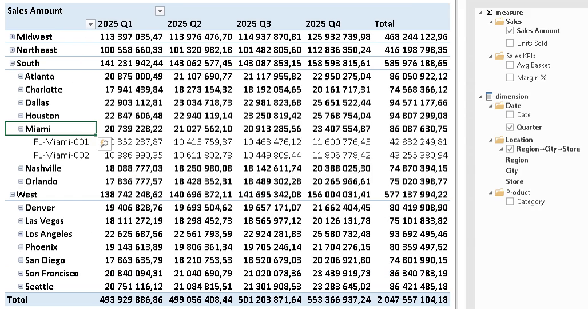

XLTable Documentation
=====================

.. rst-class:: landing-lead

**Semantic Layer for Big Data.** Self-service analytics on big data —
governed by IT, loved by users.

XLTable is an XMLA-compatible OLAP semantic layer for modern analytical
databases. Business users explore data in native **Excel Pivot Tables**, in
a **pivot table in the browser**, through **AI assistants** or in BI tools —
no SQL for end users, no data copies, no add-ins. Every client works on the
same cubes with the same numbers and access rights, and all queries run
inside your warehouse.

.. grid:: auto
   :gutter: 2
   :class-container: landing-actions

   .. grid-item::

      .. button-ref:: quickstart
         :ref-type: doc
         :color: primary

         Install XLTable Desktop

   .. grid-item::

      .. button-link:: https://xltable.com/demo
         :color: primary
         :outline:

         Open the live demo

   .. grid-item::

      .. button-ref:: overview
         :ref-type: doc
         :color: primary
         :outline:

         What is XLTable

.. rst-class:: landing-note

XLTable Desktop is free and comes with demo data: the first Pivot Table
takes a couple of minutes, no administrator rights needed. The live demo is
a public server with sample cubes — nothing to install.

Working with cubes
------------------

.. grid:: 1 2 2 2
   :gutter: 3

   .. grid-item-card:: :octicon:`table;1em` Connecting Excel
      :link: excel
      :link-type: doc

      Native Pivot Tables over XMLA, no add-in: authentication modes,
      data refresh, slicers, drill through and file export.

   .. grid-item-card:: :octicon:`browser;1em` Web pivot table
      :link: reports
      :link-type: doc

      The same cubes as a pivot table in the browser — built to work
      like Excel, with saved reports shared by link.

   .. grid-item-card:: :octicon:`hubot;1em` AI assistants (MCP)
      :link: mcp
      :link-type: doc

      Ask questions in plain language — Claude and other MCP clients
      answer from the same cubes as Excel; the same cubes over
      :doc:`REST <api>` for scripts and portals.

   .. grid-item-card:: :octicon:`graph;1em` BI tools (SQL endpoint)
      :link: sql_endpoint
      :link-type: doc

      Cubes as PostgreSQL tables: DataLens and other tools with a
      PostgreSQL driver query them with plain SQL.

Building cubes and running the server
-------------------------------------

.. grid:: 1 2 2 2
   :gutter: 3

   .. grid-item-card:: :octicon:`stack;1em` OLAP cubes
      :link: cubes
      :link-type: doc

      Measures, dimensions, hierarchies, security roles and
      drillthrough — plain SQL plus :doc:`Jinja templating <jinja>`;
      :doc:`cube structure and status <web_cubes>` in the browser.

   .. grid-item-card:: :octicon:`list-unordered;1em` Cube definition reference
      :link: reference
      :link-type: doc

      Every SQL tag of a cube definition with examples, and the
      unified example cube the samples are built on.

   .. grid-item-card:: :octicon:`server;1em` Installation
      :link: install
      :link-type: doc

      The server edition for a team: Linux and Windows Server,
      licensing, authentication and Active Directory.

   .. grid-item-card:: :octicon:`gear;1em` Configuration
      :link: settings
      :link-type: doc

      Every parameter of ``settings.json``, with
      :doc:`database connections <databases>` and
      :doc:`caching <cache>` on their own pages.

Supported data sources
----------------------

All heavy computation runs inside your database — XLTable pushes queries down
to your warehouse, with no extracts and no in-memory copies. A read-only
service account is all it needs — see :doc:`databases` for connection
examples. Each database below opens its ready-to-run sample: a script with
test data and a cube.

.. grid:: 2 4 4 4
   :gutter: 2
   :class-container: landing-sources

   .. grid-item-card:: ClickHouse
      :link: clickhouse_sample
      :link-type: doc

   .. grid-item-card:: BigQuery
      :link: bigquery_sample
      :link-type: doc

   .. grid-item-card:: Snowflake
      :link: snowflake_sample
      :link-type: doc

   .. grid-item-card:: Trino
      :link: trino_sample
      :link-type: doc

   .. grid-item-card:: Greenplum
      :link: greenplum_sample
      :link-type: doc

   .. grid-item-card:: StarRocks
      :link: starrocks_sample
      :link-type: doc

   .. grid-item-card:: Databricks
      :link: databricks_sample
      :link-type: doc

   .. grid-item-card:: DuckDB
      :link: duckdb_sample
      :link-type: doc

.. rst-class:: landing-note

ClickHouse is supported from version 22.5.

Why XLTable?
------------

- Native Excel Pivot Tables on big data — drag-and-drop over the standard
  SSAS/XMLA workflow, no SQL, no retraining
- Centralized semantic layer: dimensions, measures, hierarchies, calculated fields
- One model, every client: the same cube answers Excel Pivot Tables, the
  :doc:`pivot table in the browser <reports>`, AI assistants
  (:doc:`MCP connector <mcp>`) and BI tools (:doc:`SQL endpoint
  <sql_endpoint>`) — with the same numbers and the same access rights
- Code-first: cube definitions are plain SQL files — keep them in Git, review
  changes in pull requests, deploy through your CI/CD flow
- Fine-grained access control down to rows and members, Active Directory / LDAP integration
- Your data never leaves: queries run inside your warehouse, XLTable deploys
  inside your perimeter
- Query result caching for a fast Excel experience
- Self-hosted on Linux or Windows, on-premise or in the cloud
- Free desktop edition for one analyst, server edition for a team — the same
  cube files work in both (see :ref:`editions`)

Getting help
------------

Common questions and troubleshooting are collected in the :doc:`faq`; how to
collect logs for a problem report is described in :doc:`support`.

.. grid:: 1 3 3 3
   :gutter: 3

   .. grid-item-card:: :octicon:`globe;1em` Website
      :link: https://xltable.com

      Product overview, pricing and trial requests.

   .. grid-item-card:: :octicon:`comment-discussion;1em` Telegram
      :link: https://t.me/XLTable

      News, releases and quick answers from the team.

   .. grid-item-card:: :octicon:`mail;1em` Email
      :link: mailto:help@xltable.com

      help@xltable.com — support and licensing.

Working with ChatGPT, Claude or another AI assistant? Give it the whole
documentation as a single file — see :doc:`ai`.

.. toctree::
   :maxdepth: 1
   :caption: Getting started
   :hidden:

   quickstart
   overview

.. toctree::
   :maxdepth: 1
   :caption: Working with cubes
   :hidden:

   excel
   Large results and file export <export>
   reports
   AI assistants (MCP) <mcp>
   BI tools (SQL endpoint) <sql_endpoint>
   api

.. toctree::
   :maxdepth: 1
   :caption: Building cubes
   :hidden:

   cubes
   jinja
   reference
   web_cubes
   ossie
   samples

.. toctree::
   :maxdepth: 1
   :caption: Administration
   :hidden:

   install
   databases
   Warehouse connection page <connection>
   cache
   settings

.. toctree::
   :maxdepth: 1
   :caption: Help and releases
   :hidden:

   faq
   support
   ai
   changelog
   backlog
   license
