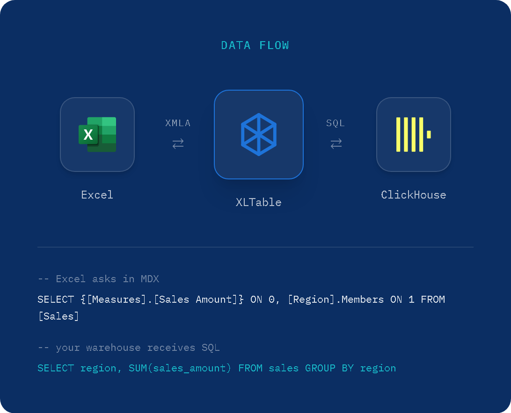

About XLTable
=============

XLTable is an XMLA-compatible OLAP semantic layer that connects **Excel Pivot
Tables**, a **pivot table in the browser**, AI assistants and BI tools
directly to modern analytical databases — without exporting data to files.
No SQL for end users, no data copies: queries are pushed down to your
warehouse, and XLTable deploys inside your perimeter.

XLTable acts as a **semantic and security layer** between these clients and
the database: data models, access rights and performance are controlled
centrally, and every client answers from the same cubes with the same
numbers.

It is designed for organizations that want to keep Excel as the main
analytics tool while working with large datasets stored in modern data
platforms: your warehouse stays the single source of truth.

The picture shows the Excel path; the browser, AI assistants and BI tools go
through the same engine — see `How it works (Architecture)`_.

------------------------------------------------------------

What is XLTable
---------------

XLTable enables business users to analyze large datasets using familiar
Excel Pivot Tables, the same pivot table in the browser, or by asking
questions in plain language through AI assistants — while IT teams define and
manage analytical models centrally. One model, several ways to explore it:
every client answers from the same cube, with the same numbers and the same
access rights.

.. list-table::
   :header-rows: 1
   :widths: 22 38 40

   * - Client
     - How it connects
     - What it is for
   * - :doc:`Excel <excel>`
     - Native Pivot Tables over XMLA, no add-in
     - The main tool: full pivot experience on big data
   * - :doc:`Browser <reports>`
     - The web application of the XLTable server (``/reports``)
     - The same pivot table without Excel: reports saved on the server and
       shared by link, macOS, any device with a browser
   * - :doc:`AI assistants <mcp>`
     - Built-in MCP server, :doc:`REST API <api>`
     - Questions in plain language, agents and scripts
   * - :doc:`BI tools <sql_endpoint>`
     - SQL endpoint: the PostgreSQL protocol, cubes as tables (server
       edition)
     - Dashboards in DataLens and other tools with a PostgreSQL driver, SQL
       clients

Unlike classic BI tools, XLTable does not replace Excel.
Instead, it extends Excel with enterprise-grade OLAP capabilities:

- Dimensions, measures and hierarchies
- Calculated fields and reusable metrics
- Fine-grained access control down to rows and members
- Query result caching
- Integration with Active Directory / LDAP
- Web pivot table: the Excel-like pivot in the browser, saved reports shared
  by link
- MCP connector for Claude and other AI assistants

Cube definitions are plain SQL files: keep them in Git, review changes in
pull requests, deploy through the CI/CD flow your team already uses.

XLTable is typically used by finance teams, analysts, controllers and managers
who require both flexibility and governance.

------------------------------------------------------------

.. _editions:

Editions
--------

XLTable comes in two editions. They read the same cube definitions: a cube
built in XLTable Desktop works on the server unchanged (see
:ref:`upgrade_from_free`).

.. list-table::
   :header-rows: 1
   :widths: 22 39 39

   * -
     - XLTable Desktop (free)
     - Server edition
   * - For
     - One analyst on their own machine
     - A team: many users over the network
   * - Runs on
     - Windows 10 / 11, no administrator rights
     - Linux or Windows Server (IIS)
   * - Sign-in
     - None: a single local user, reachable from this machine only
     - Local accounts or Active Directory, single sign-on
   * - License
     - Not required
     - A license file, per named user; a trial license is free
   * - Clients
     - Excel, the web pivot table, AI assistants (MCP), REST API
     - The same and the SQL endpoint for BI tools; the web pivot table, MCP,
       the REST API and the SQL endpoint are license options
   * - Cube definitions
     - ``.sql`` files in a local folder
     - ``.sql`` files in a folder or the ``olap_definition`` table of the
       warehouse
   * - Start with
     - :doc:`quickstart` — comes with built-in demo data
     - :doc:`install`

To look at XLTable without installing anything, open the public demo server:
https://xltable.com/demo.

------------------------------------------------------------

How it works (Architecture)
---------------------------

XLTable is positioned between its clients and analytical databases
and serves as an OLAP and semantic layer.

Excel connects to XLTable using the standard XMLA protocol.
XLTable receives MDX queries from Pivot Tables and translates them
into optimized SQL queries executed directly in the database.

The web pivot table and AI assistants use the same engine: a layout built in
the browser or a question asked through MCP goes through the same cube
definition, the same security rules and the same SQL generation — the SQL
behind a browser layout is exactly the SQL Excel sends for the same layout,
so the clients share the cache and show the same numbers.

Architecture flow
^^^^^^^^^^^^^^^^^

1. A client sends an analytical request: Excel in MDX over XMLA, the browser
   and AI assistants over the server's HTTP API and MCP, BI tools in SQL
   over the PostgreSQL protocol (:doc:`sql_endpoint`)
2. XLTable applies semantic model and security rules
3. SQL queries are generated and executed in the database
4. Results are cached and returned to the client

This approach ensures that:

- All heavy computations stay inside the database
- Excel and the browser remain fast and responsive
- Business logic is defined once and reused consistently

------------------------------------------------------------

.. _ssas_comparison:

Comparison with SSAS
--------------------

The table below lists the main features of Microsoft SQL Server Analysis Services (SSAS)
and indicates which of them are available in XLTable.

.. list-table::
   :header-rows: 1
   :widths: 60 20 20

   * - Feature
     - SSAS
     - XLTable
   * - **Data Modeling**
     -
     -
   * - Multidimensional cubes (dimensions, measures, hierarchies)
     - ✓
     - ✓
   * - Tabular models (in-memory columnar)
     - ✓
     -
   * - Calculated measures (calculated fields)
     - ✓
     - ✓
   * - Named sets
     - ✓
     -
   * - KPIs (Key Performance Indicators)
     - ✓
     -
   * - Perspectives (virtual cube subsets)
     - ✓
     -
   * - Field display names (translations)
     - ✓
     - ✓
   * - **Query Languages**
     -
     -
   * - MDX (Multidimensional Expressions)
     - ✓
     - ✓
   * - DAX (Data Analysis Expressions)
     - ✓
     -
   * - XMLA protocol
     - ✓
     - ✓
   * - **Performance & Storage**
     -
     -
   * - Query result caching
     - ✓
     - ✓
   * - Partitions
     - ✓
     - ✓ (native warehouse partitioning — queries are pushed down, the
       database prunes partitions)
   * - Pre-computed aggregations
     - ✓
     - ✓
   * - Proactive caching
     - ✓
     - ✓
   * - DirectQuery (pass-through to source database)
     - ✓
     - ✓
   * - **Security**
     -
     -
   * - Role-based access control
     - ✓
     - ✓
   * - Row-level security
     - ✓
     - ✓
   * - Dimension security
     - ✓
     - ✓
   * - Active Directory / LDAP integration
     - ✓
     - ✓
   * - **Client Integration**
     -
     -
   * - Excel PivotTable connectivity
     - ✓
     - ✓
   * - Power BI connectivity
     - ✓
     -
   * - Management tools (SSMS)
     - ✓
     -
   * - Drillthrough (cell to detail rows)
     - ✓
     - ✓
   * - Full export of a Pivot Table to a CSV file, without the pivot size cap
       (see :ref:`excel_export`)
     -
     - ✓
   * - AI assistants connectivity (built-in :doc:`MCP server <mcp>`)
     -
     - ✓
   * - Pivot table in the browser (:doc:`web pivot table <reports>`): the same
       cubes without Excel, reports shared by link
     -
     - ✓
   * - Cubes as PostgreSQL tables for BI tools (:doc:`SQL endpoint
       <sql_endpoint>`)
     -
     - ✓
   * - **Administration**
     -
     -
   * - Full data processing (ETL-like refresh)
     - ✓
     -
   * - Incremental processing
     - ✓
     -
   * - Admin / monitoring interface
     - ✓
     - ✓

------------------------------------------------------------

Deployment steps
----------------

A typical deployment of the server edition consists of several simple stages.
Most installations can be completed in less than one hour. On a single
machine none of this is needed: XLTable Desktop installs in a couple of
minutes — see :doc:`quickstart`.

1. Prepare infrastructure
^^^^^^^^^^^^^^^^^^^^^^^^^

Prepare a Linux or Windows server according to the
:ref:`system requirements <system_requirements>`.
XLTable can be deployed on-premise or in the cloud.

2. Install XLTable
^^^^^^^^^^^^^^^^^^

Install the XLTable service, upload a license and configure users — see
:doc:`install`.

3. Configure database connections
^^^^^^^^^^^^^^^^^^^^^^^^^^^^^^^^^

Define the connection to your analytical database — ClickHouse, BigQuery,
Snowflake, Trino, Greenplum, StarRocks, Databricks or DuckDB. Connection
settings are stored centrally — see :doc:`databases`.

4. Define OLAP cubes
^^^^^^^^^^^^^^^^^^^^

Create OLAP cube definitions using SQL-based configuration files.
Define dimensions, measures, calculated fields and access rules — see
:doc:`cubes`; a ready cube with test data for every database is in
:doc:`samples`.

5. Connect clients
^^^^^^^^^^^^^^^^^^

Connect Excel Pivot Tables to XLTable using XMLA (:doc:`excel`)
and start analyzing data immediately. The same cubes are then available in
the browser (:doc:`reports`), to AI assistants (:doc:`mcp`) and to BI tools
(:doc:`sql_endpoint`) with no extra modeling.

------------------------------------------------------------

.. _system_requirements:

System requirements
-------------------

XLTable is designed for enterprise environments
and supports both physical and virtual deployments.

Operating systems
^^^^^^^^^^^^^^^^^

- Linux (Ubuntu 22.04+ recommended)
- Windows 10 / 11
- Windows Server 2019+

Hardware requirements
^^^^^^^^^^^^^^^^^^^^^

Minimum:

- 4 CPU cores
- 16 GB RAM
- 50 GB disk space

Recommended:

- 8+ CPU cores
- 32 GB RAM
- SSD storage

Network requirements
^^^^^^^^^^^^^^^^^^^^

- Stable network connection between XLTable server and analytical databases
- Network access for Excel clients, browsers and AI assistants to XLTable
  server on port 80 or 443 (the web front of a server installation; a
  standalone server listens on :confval:`SERVER_PORT`, 5000 by default)
- Port 5433 for BI tools when the :doc:`SQL endpoint <sql_endpoint>` is used
- Access to Active Directory (optional)

System requirements may vary depending on data volume,
number of users and complexity of OLAP models.

------------------------------------------------------------

Testing and purchasing
----------------------

- **Try it without installing** — the public demo server:
  https://xltable.com/demo.
- **Try it on your machine** — the free XLTable Desktop: :doc:`quickstart`.
- **Pilot the server edition** — a trial license is issued free of charge,
  see :ref:`obtaining_license`.

For pricing see https://xltable.com/#pricing; for testing and purchasing
contact us by email help@xltable.com or Telegram https://t.me/XLTable.
